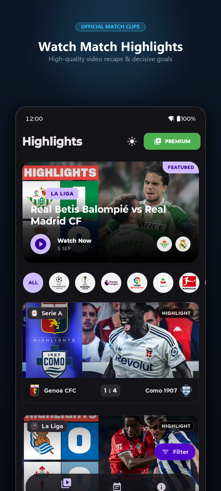
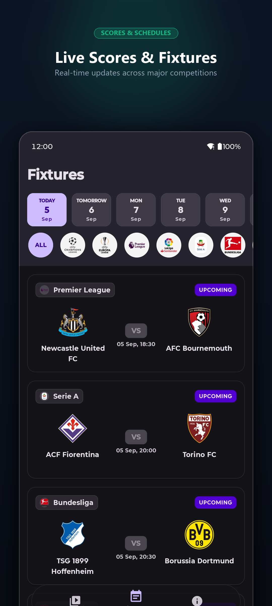
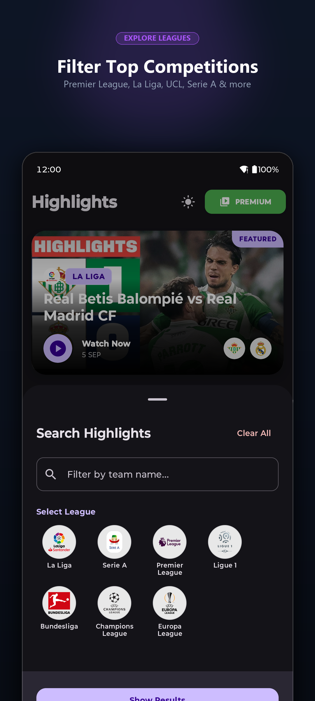
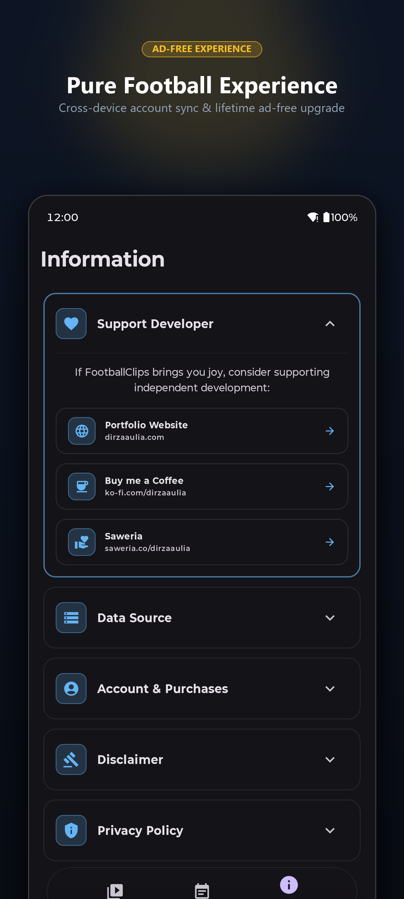
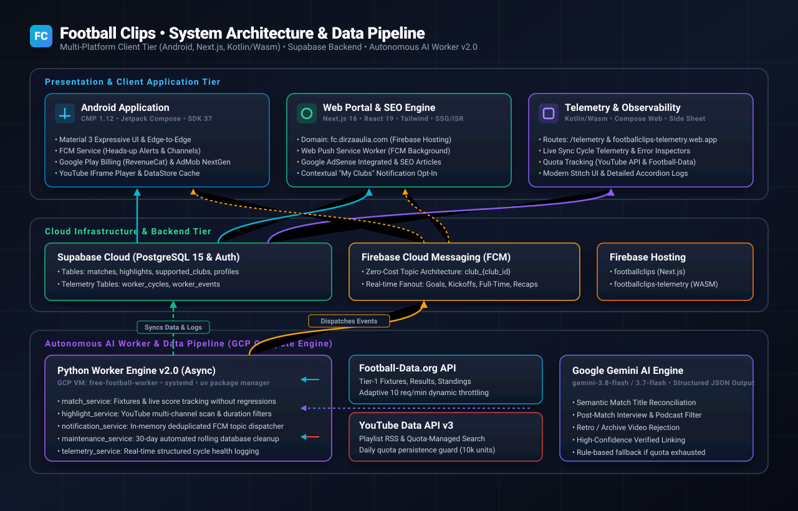

# ⚽ Football Clips (Compose Multiplatform & Next.js Web Platform)

<div align="center">


### Watch Official Match Highlights, Follow Real-Time Scores & Receive Live Club Alerts

[](https://kotlinlang.org)
[](https://www.jetbrains.com/lp/compose-multiplatform/)
[-3DDC84?style=for-the-badge&logo=android&logoColor=white)](https://developer.android.com)
[](https://fc.dirzaaulia.com)
[](https://fc.dirzaaulia.com/telemetry)
[](https://supabase.com)
[](https://play.google.com/store/apps/details?id=com.dirzaaulia.footballclips)

</div>

---

## 📱 Google Play Store Marketing Showcase

Here are the official high-resolution marketing banners featured on the Google Play Store listing:

<div align="center">
  <table>
    <tr>
      <td align="center" width="25%">
        
        <br />
        <b>🎬 Watch Match Highlights</b>
        <br />
        <sub>High-quality video recaps & decisive goals</sub>
      </td>
      <td align="center" width="25%">
        
        <br />
        <b>⚡ Live Scores & Fixtures</b>
        <br />
        <sub>Real-time updates across top leagues</sub>
      </td>
      <td align="center" width="25%">
        
        <br />
        <b>🏆 Filter Top Competitions</b>
        <br />
        <sub>Premier League, La Liga, UCL, Serie A & more</sub>
      </td>
      <td align="center" width="25%">
        
        <br />
        <b>💎 Pure Football Experience</b>
        <br />
        <sub>Cross-device account sync & lifetime ad-free</sub>
      </td>
    </tr>
  </table>
</div>

---

## ✨ Key Features

- 🎥 **HD Official Match Highlights**: Curated, decisive goals, and extended match highlights from official club channels and authorized broadcast partners without clickbait.
- ⚡ **Live Scores & Real-Time Match Events**: Live scoreboards with interactive status indicators (`LIVE`, `FINISHED`, `SCHEDULED`), team crests, and kickoff schedules.
- 🔔 **Real-Time Club Push Notifications ($0.00 Cost Architecture)**:
  - Broadcasts across 5 critical match phases: **Highlight Available**, **Going to Play (Countdown)**, **In Play (Kickoff)**, **Score Updated (Live Goals)**, and **Finish Match (Full Time)**.
  - Delivered via **Firebase Cloud Messaging (FCM) Topics** (`club_{club_id}`) with zero database polling overhead or per-user token storage.
- ⭐ **My Clubs Pinning & Contextual Permission Flow**:
  - Save favorite clubs to personalize fixtures, scoreboards, and alert subscriptions.
  - Adheres strictly to modern permission guidelines: **Zero cold-start permission popups**. Contextual soft-ask rationale sheets are presented naturally when a user stars a club.
- 🎨 **Material 3 Expressive Design**: 
  - Dynamic edge-to-edge layout on Android (Target SDK 37, AGP 9.4).
  - Signature Droplet circular-reveal dark/light theme switching animation.
  - Floating pill navigation bar with dynamic badge indicators.
- 🌐 **Modern Multi-Platform Architecture**: 
  - **Android Native App**: Jetpack Compose & Compose Multiplatform, hardware-accelerated inline and fullscreen YouTube player, heads-up FCM notifications.
  - **Web Portal ([fc.dirzaaulia.com](https://fc.dirzaaulia.com))**: Built with **Next.js 16 (React 19 & Turbopack)** with Static Site Generation (SSG), Incremental Static Regeneration (ISR), Web Push service worker, and Google AdSense integration.
  - **APM Command Center ([fc.dirzaaulia.com/telemetry](https://fc.dirzaaulia.com/telemetry))**: High-performance **Kotlin/Wasm** real-time observability platform with live OpenMetrics streaming, edge cache purging, on-demand cycle triggers, and latency benchmarking.
- 💎 **Universal Account & In-App Purchase Sync**:
  - Google Native Sign-In via Supabase Auth.
  - Google Play In-App Billing (RevenueCat SDK 10.26) for Android.
  - Cross-device entitlement synchronization stored securely in Supabase PostgreSQL (`profiles` table).

---

## 🏛️ System Architecture

<div align="center">
  <a href="docs/assets/architecture.svg">
    
  </a>
  <p align="center">
    <sub>🔍 <b>High-Resolution Vector Diagram</b>: Click diagram to open in full screen (or <a href="docs/assets/architecture.svg?raw=true">view raw vector</a> for infinite native zoom &amp; pan).</sub>
  </p>
</div>

### Architectural Tiers Breakdown

| Layer / Tier | Technology Stack | Responsibilities & Capabilities |
| :--- | :--- | :--- |
| **Presentation: Android** | Compose Multiplatform 1.12.1<br/>Jetpack Compose, SDK 37 | Material 3 Expressive UI, Hardware-accelerated YouTube player, FCM messaging service (`FootballClipsFirebaseMessagingService`), RevenueCat Google Play billing, NextGen AdMob. |
| **Presentation: Web Portal** | Next.js 16, React 19, TypeScript<br/>Tailwind CSS, Turbopack | Primary public web portal (`fc.dirzaaulia.com`), SSG/ISR static export, Web Push background Service Worker (`firebase-messaging-sw.js`), Google AdSense ads, contextual notification modal. |
| **Presentation: APM Command Center** | Kotlin/Wasm (WebAssembly)<br/>Compose Web Multiplatform | Real-time observability dashboard (`/telemetry`), live OpenMetrics stream (`/metrics`), interactive cycle dispatcher, instant Cloudflare cache invalidation, and edge benchmark tester. |
| **Global Edge Proxy Tier** | Cloudflare Workers (`fc-edge-proxy`)<br/>Edge Cache API | Sub-15ms edge caching layer (`fc-edge-proxy.dirzaaulia11.workers.dev`), multi-tier TTL (30s live, 24h finished, 6h standings), instant purge API (`/api/purge-cache`), and Supabase connection pool protection. |
| **Cloud Backend & Database** | Supabase Cloud (PostgreSQL 15)<br/>Supabase Auth & Postgrest | Normalized tables (`matches`, `highlights`, `supported_clubs`, `profiles`), worker telemetry logs (`worker_cycles`, `worker_events`), Google OAuth authentication. |
| **Push Notification Network** | Firebase Cloud Messaging (FCM)<br/>Topic Architecture: `club_{id}` | Global edge fanout delivering goal alerts, match schedules, and highlight releases to millions of Android devices and Web browsers at **\$0 infrastructure cost**. |
| **Serverless AI Worker Engine** | Python 3.12, FastAPI, Asyncio<br/>Google Cloud Run (`fc-worker`) | Containerized serverless worker on Cloud Run with automated scale-to-zero, real-time YouTube WebSub push receiver, ESPN sports engine, and Gemini 3.8 Flash AI re-ranking. |
| **Cron Scheduling Fleet** | Google Cloud Scheduler<br/>3 Perpetual Free Jobs | Drives worker execution cadences (5m standard, 1m weekend peak live, weekly WebSub renewal) strictly within the 100% free perpetual tier. |

---

## 🛠️ Modern Tech Stack

| Category | Technology | Version | Description |
| :--- | :--- | :--- | :--- |
| **Language** | **Kotlin** | `2.4.21` | Modern compiler with K2 engine & multiplatform targets |
| **Build System** | **Android Gradle Plugin (AGP)** | `9.4.0` | Latest Gradle configuration with Target SDK 37 |
| **UI Framework (Mobile/Wasm)** | **Compose Multiplatform** | `1.12.1` | Declarative UI for Android Native and WebAssembly |
| **Web Portal Engine** | **Next.js (App Router)** | `16.4.0` | React 19, Turbopack, Tailwind CSS, Static Export (SSG/ISR) |
| **Target Platform (Android)** | **Android 16 / SDK 37** | SDK 37 | Min SDK 24, compile & target SDK 37 |
| **Dependency Injection** | **Koin** | `4.2.2` | `koin-core`, `koin-compose`, `koin-compose-viewmodel` |
| **Networking** | **Ktor Client** | `3.6.0` | HTTP client with OkHttp engine on Android and Fetch on Wasm |
| **Image Loading** | **Coil** | `3.6.3` | `coil-compose`, `coil-network-ktor3`, `coil-svg` |
| **Global Edge Proxy** | **Cloudflare Workers** | Edge | Sub-15ms edge caching proxy (`fc-edge-proxy`) with instant cache purge |
| **Backend & Database** | **Supabase Kotlin** | `3.8.0` | Postgrest REST API, GoTrue Auth, Realtime |
| **Push Notifications** | **Firebase Messaging (FCM)** | `35.0.0` / `7.7.0` | Android FCM SDK, Web Push Worker, Python `firebase-admin` |
| **In-App Billing** | **RevenueCat Purchases** | `10.26.0` | Google Play Store lifetime non-consumable billing |
| **Mobile Ads** | **Google Mobile Ads NextGen** | `1.5.0` | Policy-compliant native ads & adaptive banner views |
| **Web Ads** | **Google AdSense** | Cloud | Responsive display ads adhering to Google publisher policies |
| **Serverless Worker Fleet** | **Google Cloud Run** | Revision 8 | Serverless container (`fc-worker`) with automated scale-to-zero |
| **Scheduler Engine** | **Google Cloud Scheduler** | Cloud | 3 Free perpetual cron jobs (5m sync, 1m weekend live, Sunday WebSub renew) |
| **Sports Data Engine** | **ESPN Sports API** | Public | Zero rate limit, 0 API quota, full European 2026/2027 coverage |
| **Video Highlight Ingestion** | **YouTube WebSub + RSS** | Zero Quota | Google PubSubHubbub push notifications + official channel RSS |
| **AI Semantic Re-ranker** | **Google Gemini AI** | `gemini-3.8-flash` | Structured JSON semantic video matching with token-bucket rate limiter |
| **Hosting & CDN** | **Firebase Hosting** | Multi-Site | Hosting targets for Next.js web portal and Wasm telemetry |

---

## 🤖 Serverless AI Worker & Event-Driven Engine

Match fixtures, live scores, and verified video highlights are synchronized autonomously via the containerized Python worker engine on Google Cloud Run:

```
                                  [Cloud Scheduler]
                                         │
                                         ▼ (HTTP POST /run-cycle)
[ESPN Sports API] ───────► [match_service.py] ──────► [Supabase DB (PostgreSQL)]
(0 Rate Limit, 0 Quota)          │                               ▲
                                 ▼                               │
                      [notification_service.py]                  │
                                 │                               │
                                 ▼ (FCM Topics: club_{id})       │
                       [Android & Web Push]                      │
                                                                 │
[YouTube WebSub Push] ───► [FastAPI /websub]                     │
[Official Channel RSS] ──► [highlight_service.py] ───────────────┤
                                 │ (Gemini 3.8 Flash AI)         │
                                 ▼                               ▼
                      [EdgeCacheClient (Purge)] ──► [Cloudflare Edge Proxy]
                                                    (fc-edge-proxy)
```

1. **Fixture & Live Score Synchronization (`match_service.py`)**:
   - Queries Tier-1 competitions from ESPN's public endpoints with zero rate-limit constraints and zero cost.
   - Prevents status and score regressions on delayed upstream updates.
2. **Event-Driven YouTube WebSub & RSS Discovery (`highlight_service.py`)**:
   - Ingests real-time upload webhooks via Google PubSubHubbub (`POST /websub`) for $<100\text{ms}$ instant match linking.
   - Scans official club and league YouTube RSS feeds with **0 YouTube API quota spent**.
3. **AI Semantic Reconciliation (`gemini_client.py`)**:
   - Employs **Gemini 3.8 Flash** with structured JSON output and a 12 RPM sliding-window token bucket.
   - Seamless rule-based heuristic scoring fallback if AI quota hits rate limits.
4. **Real-Time Notification Dispatcher (`notification_service.py`)**:
   - Formats channel-specific payloads for goals, kickoff reminders, and highlight releases.
   - Utilizes an in-memory 24-hour event deduplicator preventing duplicate alerts.
5. **Self-Healing & Automated Maintenance (`maintenance_service.py`)**:
   - Recovers matches stuck in `IN_PLAY` beyond 180 minutes and rolls forward stale fixtures.
   - Continuously purges matches, highlights, and telemetry events older than 30 days.

---

## 📁 Project Structure

```
FootballClips/
├── .github/workflows/          # GitHub Actions CI/CD deployment pipelines
├── androidApp/                 # Android Native application module
│   ├── src/main/kotlin/        # Application class, MainActivity, and FCM Service
│   └── build.gradle.kts        # Android App build & signing configuration
├── cloudflare/                 # Cloudflare Workers Edge Caching Proxy (fc-edge-proxy)
│   ├── src/index.ts            # Multi-tier edge caching & instant cache purge API
│   └── wrangler.toml           # Cloudflare deployment configuration
├── composeApp/                 # Shared Kotlin Multiplatform codebase
│   ├── src/commonMain/         # Shared Compose Multiplatform UI, ViewModels, & Repositories
│   └── src/androidMain/        # Android-specific KMP implementations & Koin modules
├── web/                        # Next.js 16 Web Portal (Primary Public Website)
│   ├── src/app/                # App Router (pages: /, /fixtures, /standings, /match/[id])
│   ├── src/components/         # React 19 UI components & My Clubs notification modal
│   ├── src/lib/firebase/       # Firebase Messaging client initialization
│   ├── public/                 # Web Push service worker (firebase-messaging-sw.js)
│   └── package.json            # Next.js dependencies & scripts
├── webApp/                     # Kotlin/Wasm APM Observability & Command Center
│   ├── src/wasmJsMain/kotlin/  # Live OpenMetrics viewer, Edge latency benchmark, Action toolbar
│   └── build.gradle.kts        # Wasm browser distribution build config
├── worker/                     # Python Serverless Worker & APM Engine
│   ├── clients/                # Supabase, ESPN, YouTube RSS, Gemini AI, and Edge Cache clients
│   ├── services/               # Match, Highlight, Notification, Standings, & Maintenance services
│   ├── tests/                  # Pytest unit tests (38/38 passing)
│   ├── server.py               # FastAPI server (/metrics, /health, /status, /run-cycle, /websub)
│   ├── Dockerfile              # Container definition for Google Cloud Run
│   └── main.py                 # Async worker loop & cycle orchestrator
├── docs/                       # Architectural documentation & high-resolution vector assets
│   └── assets/architecture.svg # Standalone vector architecture diagram
├── scripts/                    # Deployment & ASO management utilities
│   ├── deploy_web.py           # Unified Next.js & Wasm build/deploy script for Firebase Hosting
│   └── deploy_production.py    # Production deployment utility
└── gradle/libs.versions.toml   # Centralized version catalog
```

---

## 🚀 Getting Started

### Prerequisites

- **JDK 17** or **JDK 21** (Temurin recommended)
- **Android Studio Ladybug (2024.2+)** with Kotlin Multiplatform plugin
- **Android SDK 37** build-tools installed
- **Node.js 20+** (for Next.js web application)
- **Python 3.12+** and [`uv`](https://docs.astral.sh/uv/) package manager

### 1. Build & Run Android App

```bash
# Build debug APK
./gradlew :androidApp:assembleDebug

# Verify file line budgets (< 250 lines per file)
./gradlew checkLineBudget

# Install and run on connected Android device/emulator
./gradlew :androidApp:installDebug
```

### 2. Run Next.js Web Application

```bash
cd web

# Install dependencies
npm install

# Start local development server with Turbopack
npm run dev

# Build production static export (SSG/ISR)
npm run build
```

The web application will be accessible at `http://localhost:3000`.

### 3. Build & Run Telemetry Dashboard (Kotlin/Wasm)

```bash
# Run local development server
./gradlew :webApp:wasmJsBrowserDevelopmentRun

# Build production distribution for deployment
./gradlew :webApp:wasmJsBrowserDistribution
```

### 4. Run Background AI Worker Engine

```bash
cd worker

# Install dependencies via uv
uv sync

# Run test suite
uv run pytest

# Start worker engine
uv run python main.py
```

### 5. Deploy Web & Telemetry to Firebase Hosting

Run the unified deployment script to compile Next.js, bundle the Wasm telemetry dashboard, and deploy both to Firebase Hosting:

```bash
python scripts/deploy_web.py
```

---

## 🚢 CI/CD & Deployment

- **Android Tracks (Play Store)**: Automated publishing via Fastlane and GitHub Actions to **Internal**, **Alpha**, **Beta**, and **Production** tracks with automated keystore management.
- **Web & Telemetry (Firebase Hosting)**: Multi-site hosting targets:
  - **Main Web Portal**: [https://fc.dirzaaulia.com](https://fc.dirzaaulia.com) (Fallback: `https://footballclips.web.app`)
  - **Telemetry Dashboard**: [https://fc.dirzaaulia.com/telemetry](https://fc.dirzaaulia.com/telemetry) (Standalone: `https://footballclips-telemetry.web.app`)
- **Worker Daemon (GCP Compute Engine)**: Managed via `systemd` (`football-worker.service`) on VM `free-football-worker` with automatic restart and rolling log retention.

---

## 📄 License

This project is proprietary and maintained by [dirzaaulia](https://github.com/dirzaaulia). All rights reserved.
