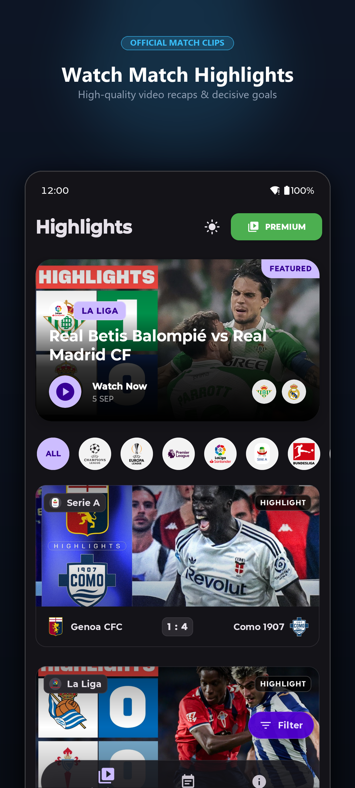
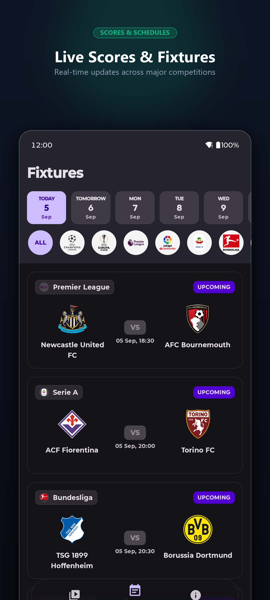
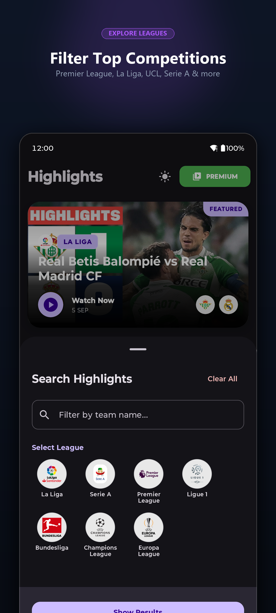
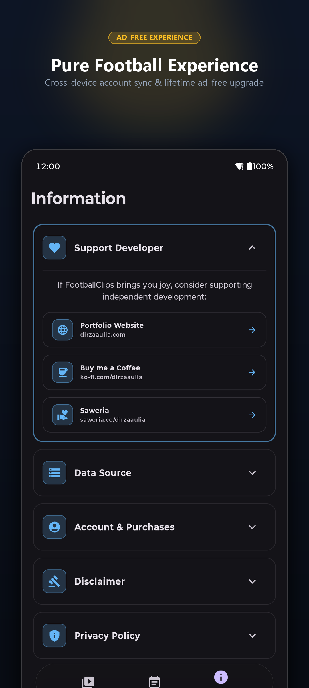
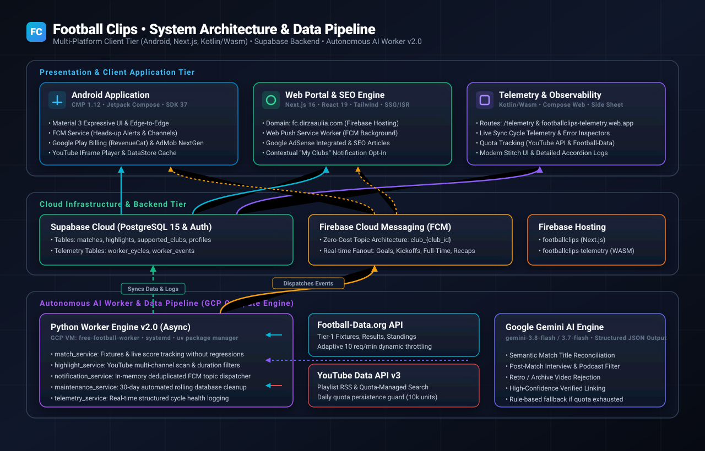

# ⚽ Football Clips (Compose Multiplatform & Next.js Web Platform)

<div align="center">


### Watch Official Match Highlights, Follow Real-Time Scores & Receive Live Club Alerts

[](https://kotlinlang.org)
[](https://www.jetbrains.com/lp/compose-multiplatform/)
[-3DDC84?style=for-the-badge&logo=android&logoColor=white)](https://developer.android.com)
[](https://fc.dirzaaulia.com)
[](https://fc.dirzaaulia.com/telemetry)
[](https://postgresql.org)
[](https://play.google.com/store/apps/details?id=com.dirzaaulia.footballclips)

</div>

---

## 📱 Google Play Store Marketing Showcase

Here are the official high-resolution marketing banners featured on the Google Play Store listing:

<div align="center">
  <table>
    <tr>
      <td align="center" width="25%">
        
        <br />
        <b>🎬 Watch Match Highlights</b>
        <br />
        <sub>High-quality video recaps & decisive goals</sub>
      </td>
      <td align="center" width="25%">
        
        <br />
        <b>⚡ Live Scores & Fixtures</b>
        <br />
        <sub>Real-time updates across top leagues</sub>
      </td>
      <td align="center" width="25%">
        
        <br />
        <b>🏆 Filter Top Competitions</b>
        <br />
        <sub>Premier League, La Liga, UCL, Serie A & more</sub>
      </td>
      <td align="center" width="25%">
        
        <br />
        <b>💎 Pure Football Experience</b>
        <br />
        <sub>Cross-device account sync & lifetime ad-free</sub>
      </td>
    </tr>
  </table>
</div>

---

## ✨ Key Features

- 🎥 **HD Official Match Highlights**: Curated, decisive goals, and extended match highlights from official club channels and authorized broadcast partners without clickbait.
- ⚡ **Live Scores, Match Clocks & Real-Time Events**: Real-time scoreboards with live match minute badges (`LIVE 74'`, `HT`, `FINISHED`, `SCHEDULED`), team crests, and kickoff schedules across both Android CMP and Web.
- 📺 **TV Broadcast Live News Ticker**: Smooth, continuous auto-scrolling live scoreboard ticker on Web (`LiveScoreTicker.tsx`) with hover-pause and frosted glass crests.
- 📂 **Collapsible Accordion Feed by Competition**: Grouped competition sections with smooth expand/collapse accordions on both Android CMP and Next.js Web for effortless scanning.
- 🛡️ **Universal Frosted Glass Logos & Crests (`GlassLogoBadge`)**: Standardized frosted glass backgrounds for all club crests and tournament emblems across Android and Web for premium visibility and high contrast.
- 🎛️ **Synchronized Navigation Rail**: Seamlessly synced collapsed side rail featuring Season Selector, Starred My Clubs with real-time counter, Spoiler-Free mode toggle, and Go Premium action dock.
- 🏆 **Broad Worldwide Competition Coverage**:
  - **European Elite**: Premier League, LaLiga, Serie A, Bundesliga, Ligue 1, Eredivisie, Liga Portugal.
  - **UEFA Tournaments**: UEFA Champions League, Europa League, Conference League, FA Cup, Carabao Cup, Copa del Rey, DFB-Pokal, Coppa Italia.
  - **Asian & Middle Eastern Giants**: AFC Champions League Elite, Saudi Pro League, Liga 1 Indonesia (native ESPN `idn.1` ingestion).
  - **South & North Americas**: CONMEBOL Libertadores, Copa Sudamericana, Recopa Sudamericana, Brasileirão Série A, Argentine Liga Profesional, Major League Soccer.
- 📅 **Dual-Season Multi-Platform Coverage (Active 2026/27 & Historical 2025/26)**:
  - **Active 2026/27 Campaign**: Real-time live scores, 2D interactive pitch radar, short-form video reels, and autonomous AI-reranked match highlights.
  - **Historical 2025/26 Archive**: Complete cross-platform browsing across 3,420+ immutable historical fixtures, official video highlights, and final standings, protected by database-level immutability triggers (`protect_archive_matches`).
- 📊 **Tactical Match Debrief & Boxscore Statistics**: In-depth match intelligence including authentic ESPN statistics (possession, shots, passes, corners, tackles), starting formations, upcoming match previews, and full-time journalistic summaries.
- 📰 **Multi-Source Football Journalistic Hub**: Accredited football news streams from Tier-1 sports journalism providers (BBC Sport, The Guardian) with real-time editorial feeds.
- 🔔 **Real-Time Club Push Notifications ($0.00 Cost Architecture)**:
  - Broadcasts across 5 critical match phases: **Highlight Available**, **Going to Play (Countdown)**, **In Play (Kickoff)**, **Score Updated (Live Goals)**, and **Finish Match (Full Time)**.
  - Delivered via **Firebase Cloud Messaging (FCM) Topics** (`club_{club_id}`) with zero database polling overhead or per-user token storage.
- ⭐ **My Clubs Pinning & Contextual Permission Flow**:
  - Save favorite clubs to personalize fixtures, scoreboards, and alert subscriptions.
  - Adheres strictly to modern permission guidelines: **Zero cold-start permission popups**. Contextual soft-ask rationale sheets are presented naturally when a user stars a club.
- 🎨 **Material 3 Expressive Design**: 
  - Dynamic edge-to-edge layout on Android (Target SDK 37, AGP 9.4).
  - Signature Droplet circular-reveal dark/light theme switching animation.
  - Floating pill navigation bar with dynamic badge indicators.
- 🌐 **Modern Multi-Platform Architecture**: 
  - **Android Native App**: Jetpack Compose & Compose Multiplatform, hardware-accelerated inline and fullscreen YouTube player, heads-up FCM notifications.
  - **Web Portal ([fc.dirzaaulia.com](https://fc.dirzaaulia.com))**: Built with **Next.js 16 (React 19 & Turbopack)** with Static Site Generation (SSG), Incremental Static Regeneration (ISR), live marquee scoreboard ticker, quick `Cmd+K` command palette, Web Push service worker, and Google AdSense integration.
  - **APM Command Center ([fc.dirzaaulia.com/telemetry](https://fc.dirzaaulia.com/telemetry))**: Ultra-fast, responsive **Next.js 16 Telemetry Console** with live 60,000 units/day YouTube API quota gauges, per-match waterfall diagnostics, granular candidate accept/reject verdict inspector, and real-time Cloud Tasks queue monitor.
- 💎 **Universal Account & In-App Purchase Sync**:
  - Google Native Sign-In with direct session management.
  - Google Play In-App Billing (RevenueCat SDK 10.26) for Android.
  - Cross-device entitlement synchronization stored securely in authoritative PostgreSQL 16 (`profiles` table).

---

## 🏛️ System Architecture

<div align="center">
  <a href="docs/assets/architecture.svg">
    
  </a>
  <p align="center">
    <sub>🔍 <b>High-Resolution Vector Diagram</b>: Click diagram to open in full screen (or <a href="docs/assets/architecture.svg?raw=true">view raw vector</a> for infinite native zoom &amp; pan).</sub>
  </p>
</div>

### Architectural Tiers Breakdown

| Layer / Tier | Technology Stack | Responsibilities & Capabilities |
| :--- | :--- | :--- |
| **Presentation: Android** | Compose Multiplatform 1.12.1<br/>Jetpack Compose, SDK 37 | Material 3 Expressive UI, Hardware-accelerated YouTube player, FCM messaging service (`FootballClipsFirebaseMessagingService`), RevenueCat Google Play billing, NextGen AdMob. Dynamic track-based version naming (`3.0.1 (buildNumber)`). |
| **Presentation: Web Portal** | Next.js 16, React 19, TypeScript<br/>Tailwind CSS, Turbopack | Primary public web portal (`fc.dirzaaulia.com`), SSG/ISR static export, Web Push background Service Worker, Google AdSense ads, custom glassmorphic dropdowns, and global season selector. |
| **Presentation: APM Command Center** | Next.js 16, React 19, Tailwind CSS<br/>Domain: `fc.dirzaaulia.com/telemetry` | Real-time observability dashboard (`/telemetry`), 60,000 units/day YouTube quota gauge, per-match waterfall traces, AI candidate evaluator cards with source badges (`[RSS]`, `[WebSub]`, `[API]`). |
| **Global Edge & REST API** | Caddy Auto-TLS & Reverse Proxy<br/>Domain: `edge.fc.dirzaaulia.com` | High-speed global edge layer exposing PostgREST 12 directly with automatic Let's Encrypt TLS 1.3, stripping client JWT headers (`header_up -Authorization`) for `web_anon`, and sub-10ms response times. |
| **Authoritative Datastore & Super-Node** | Oracle Always Free (Ampere ARM64)<br/>PostgreSQL 16, PostgREST, n8n, Caddy | Dedicated 4-core, 24GB RAM super-node hosting production PostgreSQL 16 datastore with `protect_archive_matches` immutability trigger preserving 3,420+ archive matches, AI Gateway (Ollama ARM64), n8n autonomous maintenance workflows, and automated Backblaze B2 sync. |
| **Push Notification Network** | Firebase Cloud Messaging (FCM)<br/>Topic Architecture: `club_{id}` | Global edge fanout delivering goal alerts, match schedules, and highlight releases to Android devices and Web browsers at **$0 infrastructure cost**. |
| **Core Micro-Daemon & Ingestion** | Golang 1.23+ Clean Hexagonal<br/>`fc-daemon.service` on Oracle VM | Sub-second tickers (60s live score sync, 5m highlight search, 30m round-robin shorts sweep), 0-quota Atom RSS discovery, WebSub port 8094 webhook, and 8.7MB RAM footprint. |
| **Offsite Backup & Cloud Storage** | Backblaze B2 + Rclone Sync<br/>Automated Cron Engine | Nightly automated synchronization from Backblaze B2 to the super-node cloud vault with encrypted storage and automated retention. |
| **Native Deployment & E2E CLI** | Native Go Binaries (`core-go/bin`)<br/>`fc-deploy` & `e2e-runner` | Native multi-track Google Play deployment automation with GPP integration, plus 4-layer hermetic E2E test runner. |

---

## 🛠️ Modern Tech Stack

| Category | Technology | Version | Description |
| :--- | :--- | :--- | :--- |
| **Language** | **Kotlin & Go** | `Kotlin 2.4.21` / `Go 1.23+` | Android/CMP in Kotlin; Core micro-daemon, ingestion, and deployment CLI in Go |
| **Build System** | **Android Gradle Plugin (AGP)** | `9.4.0` | Latest Gradle configuration with Target SDK 37 |
| **UI Framework (Mobile)** | **Compose Multiplatform** | `1.12.1` | Declarative UI for Android Native (Material 3 Expressive, 2D Pitch Canvas) |
| **Web Portal Engine** | **Next.js (App Router)** | `16.4.2` | React 19, Turbopack, Tailwind CSS, Live Ticker, Quick Command Palette (`Cmd+K`) |
| **Target Platform (Android)** | **Android 16 / SDK 37** | SDK 37 | Min SDK 24, compile & target SDK 37 |
| **Dependency Injection** | **Koin** | `4.2.2` | `koin-core`, `koin-compose`, `koin-compose-viewmodel` |
| **Networking** | **Ktor Client** | `3.6.0` | HTTP client with OkHttp engine on Android |
| **Image Loading** | **Coil** | `3.6.3` | `coil-compose`, `coil-network-ktor3`, `coil-svg` |
| **Global Edge & Reverse Proxy** | **Caddy 2 (TLS 1.3)** | `2.8` | High-performance reverse proxy with auto-TLS (`edge.fc.dirzaaulia.com`) routing to PostgREST |
| **Primary Datastore** | **PostgreSQL 16 (Oracle Super-Node)** | `16.4` | Enterprise PostgreSQL 16 with PostgREST 12 (0 egress limits, RLS security) |
| **Dedicated Super-Node** | **Oracle Always Free ARM64** | Ubuntu 24.04 | 4 OCPUs, 24GB RAM, PostgreSQL 16, PostgREST API, Local AI Gateway |
| **Authentication & Profiles** | **Direct Google Sign-In & PostgREST** | Native / REST | Direct Google ID verification with native session management and PostgreSQL profiles |
| **Offsite Cloud Sync** | **Backblaze B2 & Rclone** | `1.60.1` | Automated disaster recovery synchronization to super-node cloud vault |
| **Push Notifications** | **Firebase Messaging (FCM)** | `35.0.0` / Go `firebase/v4` | High-priority topic fanout for match kickoff, live scores, and video releases |
| **In-App Billing** | **RevenueCat Purchases** | `10.26.0` | Google Play Store lifetime non-consumable billing |
| **Mobile Ads** | **Google Mobile Ads NextGen** | `1.5.0` | Policy-compliant native ads & adaptive banner views |
| **Web Ads** | **Google AdSense** | Cloud | Responsive display ads adhering to Google publisher policies |
| **Core Micro-Daemon Engine** | **Go 1.23+ (`fc-daemon`)** | Version `2026.11.0` | Native daemon running as systemd service on Oracle VM with sub-second execution |
| **Deployment CLI** | **`fc-deploy` (Native Go)** | CLI | Unified deploy runner for Google Play Production & Internal tracks with priority mapping |
| **Sports Data Engine** | **ESPN Sports API** | Public | Zero rate limit, 0 API quota, full European 2026/2027 coverage |
| **Video Highlight Ingestion** | **YouTube Data API v3** | 60,000 units/day | Official approved enterprise quota + 2-stage embargo scheduler (T+15m, T+90m) |
| **AI Semantic Re-ranker** | **DeepSeek-R1 / Gemini Flash** | AI Gateway | Oracle VM Ollama DeepSeek-R1 with Gemini 2.5 Flash Lite zero-latency fallback |
| **Hosting & CDN** | **Firebase Hosting** | Multi-Site | Hosting targets for Next.js web portal and Next.js Telemetry Hub |

---

## 🤖 Serverless AI Worker & Event-Driven Engine

Match fixtures, live scores, and verified video highlights are synchronized autonomously via the containerized Python worker engine on Google Cloud Run:

```
                                  [Cloud Scheduler]
                                         │
                                         ▼ (HTTP POST /run-cycle)
[ESPN Sports API] ───────► [match_service.py] ──────► [PostgreSQL 16 DB (Oracle VM)]
(0 Rate Limit, 0 Quota)          │                               ▲
                                 ▼                               │
                      [notification_service.py]                  │
                                 │                               │
                                 ▼ (FCM Topics: club_{id})       │
                       [Android & Web Push]                      │
                                                                 │
[YouTube WebSub Push] ───► [FastAPI /websub]                     │
[Official Channel RSS] ──► [highlight_service.py] ───────────────┤
                                 │ (Gemini 3.8 Flash AI)         │
                                 ▼                               ▼
                      [EdgeCacheClient (Purge)] ──► [Edge Caddy / PostgREST]
                                                    (edge.fc.dirzaaulia.com)
```

1. **Fixture & Live Score Synchronization (`match_service.py`)**:
   - Queries Tier-1 competitions from ESPN's public endpoints with zero rate-limit constraints and zero cost.
   - Prevents status and score regressions on delayed upstream updates.
2. **Event-Driven YouTube WebSub & RSS Discovery (`highlight_service.py`)**:
   - Ingests real-time upload webhooks via Google PubSubHubbub (`POST /websub`) for $<100\text{ms}$ instant match linking.
   - Scans official club and league YouTube RSS feeds with **0 YouTube API quota spent**. For complete technical architecture, worldwide audience guarantees, and multi-tier quota maximizer, see **[`worker/PIPELINE.md`](./worker/PIPELINE.md)**.
3. **AI Semantic Reconciliation (`gemini_client.py`)**:
   - Employs **Gemini 3.8 Flash** with structured JSON output and a 12 RPM sliding-window token bucket.
   - Seamless rule-based heuristic scoring fallback if AI quota hits rate limits.
4. **Real-Time Notification Dispatcher (`notification_service.py`)**:
   - Formats channel-specific payloads for goals, kickoff reminders, and highlight releases.
   - Utilizes an in-memory 24-hour event deduplicator preventing duplicate alerts.
5. **Self-Healing & Automated Maintenance (`maintenance_service.py`)**:
   - Recovers matches stuck in `IN_PLAY` beyond 180 minutes and rolls forward stale fixtures.
   - Continuously purges matches, highlights, and telemetry events older than 30 days.

---

## 🛡️ Multi-Tier Android Backward Compatibility & Active Version Telemetry

As of October 2026, because users update at different paces across Google Play, the system strictly mandates **100% backward compatibility** across all 3 historical endpoint tiers:

| Tier | Target URL | Underlying Datastore | Status & Guardrails |
| :--- | :--- | :--- | :--- |
| **Legacy (Pre-migration)** | `https://eiomktvavndorazreyba.supabase.co` | Supabase Cloud | Synchronized with latest highlights to ensure un-upgraded devices view fresh matches |
| **Transitional (v3.0.0)** | `https://fc-edge-proxy.dirzaaulia11.workers.dev` | PostgreSQL 16 (Oracle VM) | Sub-15ms Cloudflare Anycast edge caching with automatic cache invalidation |
| **Modern (v3.0.1+)** | `https://edge.fc.dirzaaulia.com` | PostgreSQL 16 (Oracle VM) | Caddy TLS reverse proxy stripping JWT headers (`header_up -Authorization`) for `web_anon` |

### Effortless Active Version Tracking (Zero Play Console Overhead)
To track what version number users are actively running without navigating the Google Play Console:
1. **Lightweight App Session Telemetry**: Android clients send a fire-and-forget ping to `${SUPABASE_URL}/rest/v1/app_sessions` containing `app_version`, `version_code`, and `platform`.
2. **Real-Time Distribution View**: The Mission Control Next.js Telemetry Dashboard (`https://fc.dirzaaulia.com/telemetry`) displays a live 7-day version distribution (e.g. `v3.0.1: 82%`, `v3.0.0: 12%`, `v2.x: 6%`), enabling safe, data-driven decisions before retiring legacy bridges.

---

## 📁 Project Structure

```
FootballClips/
├── .github/workflows/          # GitHub Actions CI/CD deployment pipelines
├── androidApp/                 # Android Native application module
│   ├── src/main/kotlin/        # Application class, MainActivity, and FCM Service
│   └── build.gradle.kts        # Android App build & signing configuration
├── art/                        # Official high-resolution Google Play marketing banners
│   └── store_listing/          # Showcase banners featured on Google Play listing
├── composeApp/                 # Shared Kotlin Multiplatform codebase
│   ├── src/commonMain/         # Shared Compose Multiplatform UI, ViewModels, & Repositories
│   └── src/androidMain/        # Android-specific KMP implementations & Koin modules
├── core-go/                    # Golang 1.23+ Core Micro-Daemon, Ingestion & Tooling
│   ├── cmd/                    # Entrypoints: fc-daemon, fc-deploy, e2e-runner
│   ├── domain/                 # Pure domain models (matches, highlights, shorts, geo watchability)
│   ├── usecases/               # Use cases: sync_scores, find_highlight, ingest_shorts, sync_standings
│   ├── adapters/               # Adapters: postgres, espn, youtube (RSS/API), websub, fcm, aigw, edge
│   └── ports/                  # Hexagonal interface ports
├── web/                        # Next.js 16 Web Portal & Telemetry Hub (App Router)
│   ├── src/app/                # App Router (pages: /, /fixtures, /standings, /match/[id], /telemetry)
│   ├── src/components/         # React 19 UI components & interactive @xyflow graphs
│   ├── public/                 # Web Push service worker
│   └── package.json            # Next.js dependencies, build, test, and deploy scripts
├── docs/                       # Architectural documentation & high-resolution vector assets
│   ├── BACKEND_ARCHITECTURE.md # Hexagonal clean architecture & ingestion guide
│   ├── FOOTBALL_OPERATIONS_RUNBOOK.md # Production operations runbook
│   └── assets/architecture.svg # Standalone vector architecture diagram
├── oracle/                     # Oracle Always Free ARM64 Super-Node Infrastructure
│   ├── docker-compose.yml      # Multi-service topology (Postgres 16, PostgREST, FileBrowser, Caddy 2)
│   ├── Caddyfile               # Auto-TLS reverse proxy configuration
│   ├── migrations/             # Production database schema DDL migrations
│   ├── sync_backblaze.sh       # Rclone automated Backblaze B2 sync script
│   └── backup_postgres.sh      # Automated nightly PostgreSQL backup script
└── gradle/libs.versions.toml   # Centralized version catalog
```

---

## 🚀 Getting Started

### Prerequisites

- **JDK 17** or **JDK 21** (Temurin recommended)
- **Android Studio Ladybug (2024.2+)** with Kotlin Multiplatform plugin
- **Android SDK 37** build-tools installed
- **Node.js 20+** (for Next.js web application)
- **Python 3.12+** and [`uv`](https://docs.astral.sh/uv/) package manager

### 1. Build & Run Android App

```bash
# Build debug APK
./gradlew :androidApp:assembleDebug

# Verify file line budgets (< 250 lines per file)
./gradlew checkLineBudget

# Install and run on connected Android device/emulator
./gradlew :androidApp:installDebug
```

### 2. Run Next.js Web Application

```bash
cd web

# Install dependencies
npm install

# Start local development server with Turbopack
npm run dev

# Build production static export (SSG/ISR)
npm run build
```

The web application and telemetry hub will be accessible at `http://localhost:3000` (and `http://localhost:3000/telemetry`).

### 3. Run Native Go Core Micro-Daemon

```bash
cd core-go

# Run comprehensive test suite
go test -v ./...

# Run E2E test suite across all platforms
go run ./cmd/e2e-runner --all

# Start local daemon
go run ./cmd/fc-daemon
```

### 4. Deploy Web & Telemetry to Firebase Hosting

Compile Next.js and deploy the web portal and Telemetry Hub to Firebase Hosting:

```bash
cd web
npm run deploy
```

### 5. Deploy Android to Google Play (Native CLI)

```bash
# Flexible update prompt (Level 2)
core-go/bin/fc-deploy --production --prompt

# Immediate force update (Level 5)
core-go/bin/fc-deploy --production --force

# Internal testing track
core-go/bin/fc-deploy --internal
```

---

## 🚢 CI/CD & Deployment

- **Android Tracks (Play Store)**: Automated publishing via Gradle Play Publisher (GPP) and native Go `fc-deploy` to **Internal**, **Alpha**, **Beta**, and **Production** tracks with monotonic build number increments.
- **Web & Telemetry (Firebase Hosting)**: Multi-site hosting targets:
  - **Main Web Portal**: [https://fc.dirzaaulia.com](https://fc.dirzaaulia.com) (Fallback: `https://footballclips.web.app`)
  - **Telemetry Dashboard**: [https://fc.dirzaaulia.com/telemetry](https://fc.dirzaaulia.com/telemetry) (Standalone: `https://footballclips-telemetry.web.app`)
- **Core Micro-Daemon Engine**: Native Go daemon running on **Oracle Always Free ARM64** (`fc-daemon.service`) with 60s live score ticks, 0-quota Atom RSS highlight discovery, real-time WebSub push webhook (port 8094), and round-robin shorts ingestion.
- **Production Edge Infrastructure**: High-performance architecture on Oracle Cloud with Caddy 2 TLS reverse proxy, hosting PostgreSQL 16, PostgREST 12 (`https://edge.fc.dirzaaulia.com`), and automated Backblaze B2 disaster recovery sync.

---

## 📄 License

This project is proprietary and maintained by [dirzaaulia](https://github.com/dirzaaulia). All rights reserved.
