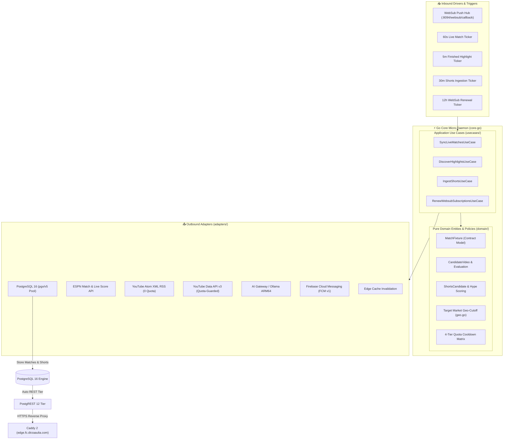

# ⚽ FootballClips Backend Architecture & Hexagonal Engineering Standards

## 1. Architectural Philosophy
The FootballClips backend is an **Autonomous Football Operations Micro-Daemon & Media Verification Engine** written in **Golang 1.23+**. 
It operates under strict **Hexagonal Clean Architecture (Ports & Adapters)** principles paired with **Event-Driven Task Execution**, running natively on an **Oracle Cloud Always Free ARM64 Ampere Super-Node** as a lightweight systemd daemon (`fc-daemon`).

---

## 2. Core Components & Responsibilities

### A. Pure Domain Layer (`core-go/domain/`)
* **`models.go`**: Strictly typed contract models matching PostgREST and Android CMP schemas (`MatchFixture`, `Competition`, `CandidateVideo`, `CandidateEvaluation`, `ShortsCandidate`, `ExecutionLog`). Zero untyped `map[string]any` dictionary passing.
* **`geo.go`**: Target Market Geo-Cutoff logic:
  * Computes worldwide watchability percentage across 249 ISO country codes.
  * `IsTargetMarketCatered`: Verifies whether country-restricted broadcaster videos cater to either the participating clubs' domestic markets or global football viewers.
  * `CheckMatchTargetMarketCutoff`: Flags matches when verified coverage reaches target thresholds, halting redundant YouTube API quota consumption.
* **`cooldown.go`**: 4-Tier Quota Guardrail protecting unlinked matches from premature re-scraping:
  * **Tier 1 (30m after FT)**: First official upload wave (Official Club channels).
  * **Tier 2 (2h after FT)**: Secondary broadcaster uploads.
  * **Tier 3 (6h after FT)**: Continental and international highlights.
  * **Tier 4 (24h after FT)**: Permanent fallback or terminal UNAVAILABLE marking.

### B. Application Use Cases (`core-go/usecases/`)
* **`SyncLiveMatchesUseCase`**:
  * Runs every 60 seconds on Oracle VM.
  * Fetches live match states from ESPN API without persisting bulky statistics to database.
  * Detects kickoff transitions (`SCHEDULED` $\rightarrow$ `IN_PLAY`), score changes, and final whistles (`FINISHED`).
  * Emits push alerts via FCM to subscribed club supporters.
* **`DiscoverHighlightsUseCase`**:
  * Receives finished matches and streams candidate videos via multi-tier discovery:
    1. **Tier 1 (Official League Channel)**: e.g. Premier League, Serie A official YouTube.
    2. **Tier 2 (Club Official Channels)**: Official channels of home & away teams.
    3. **Tier 3 (Licensed Broadcasters)**: Official regional rights holders strictly matched to competition.
  * Evaluates candidates using Oracle VM AI Gateway (DeepSeek-Coder / Qwen 2.5 on ARM64) with deterministic fallback scoring.
  * Links verified YouTube video ID, logs execution trace, and purges edge caches.
* **`IngestShortsUseCase`**:
  * Rotates through all 530+ supported clubs in batches of 50 via round-robin polling.
  * Extracts vertical 9:16 football shorts from public Atom XML RSS feeds at **zero YouTube Data API quota cost**.
  * Computes dynamic **Hype Score (10–100)** based on club tier, derby status, and freshness.
* **`RenewWebsubSubscriptionsUseCase`**:
  * Proactively renews PubSubHubbub leases every 12 hours with Google's hub (`https://pubsubhubbub.appspot.com/subscribe`).

---

## 3. Technology Stack & Operational Rationale

| Layer / Technology | Component | Operational Rationale |
| :--- | :--- | :--- |
| **Go 1.23+** | Micro-Daemon (`fc-daemon`) | Native compilation to Linux ARM64, single binary deployment, minimal memory footprint (<20MB RAM vs 300MB Python), zero GC latency spikes. |
| **`pgx/v5`** | PostgreSQL Driver | Direct binary wire protocol communication with PostgreSQL 16, integrated connection pooling (`pgxpool`), and parameterized SQL safety. |
| **PostgreSQL 16** | Core Datastore | ACID-compliant relational datastore on NVMe storage with immutable archive protection (`protect_archive_matches`). |
| **PostgREST 12** | Universal REST API | Exposes PostgreSQL tables directly over HTTP with declarative querying, eliminating duplicate API controller code. |
| **Caddy 2** | Edge Reverse Proxy | Automatic TLS certificate management via Let's Encrypt, request header sanitization (`header_up -Authorization`), and routing to PostgREST. |
| **Ollama / AI Gateway** | Reranking Engine | On-premise LLMs (Qwen 2.5 Coder 7B, DeepSeek Coder 16B) running on Oracle Ampere A1 cores at **$0.00 inference cost**. |
| **FCM HTTP v1** | Push Notifications | Direct Google OAuth2-authenticated push notifications dispatched to Android devices for favorite club kickoff and highlight events. |

---

## 4. Architectural Invariants for Developers & AI Agents

1. **Zero Secret & IP Exposure**: Never hardcode production IP addresses or plaintext database credentials. Read exclusively from environment variables or secure keystores.
2. **Historical Archive Immutability**: Historical seasons (`season < 2026`) are strictly immutable. Never run unconstrained `DELETE` or `UPDATE` queries against archive tables.
3. **Hexagonal Boundaries**:
   * `domain/` must remain pure Go with zero database, HTTP, or framework dependencies.
   * ViewModels in frontend clients remain state orchestrators with zero business logic.
4. **Idempotency & Quota Guardrails**: All highlight discovery runs must be idempotent. Repeating an execution within its cooldown window must return cached verdicts with 0 duplicate YouTube API units consumed.
