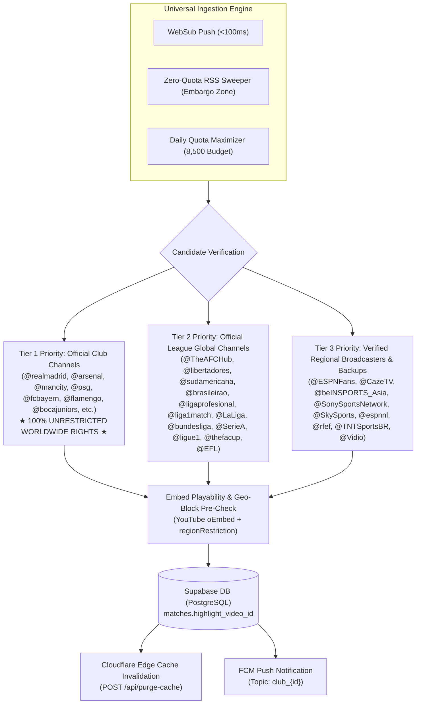
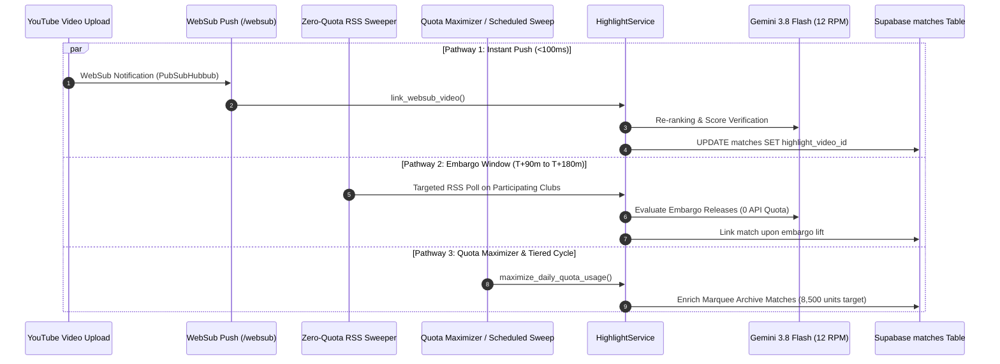

# 🎥 Autonomous YouTube Highlight Pipeline & Ingestion Engine
*Technical Specification, Worldwide Audience Architecture, Multi-Tier Quota Maximizer, and Ingestion Pathways*

---

## 🌍 Executive Overview & Worldwide Audience Architecture

The primary value of **FootballClips** is delivering high-definition, verified football match highlights without clutter or spoilers. 

Because football broadcast rights are notoriously fragmented by jurisdiction, building an ingestion pipeline that caters to a **worldwide audience across all 249 ISO countries and territories** requires an intentional hierarchy:

### Why Official Club Channels are the Worldwide Foundation
1. **Unrestricted Global Rights**: Unlike national television broadcasters (such as Sky Sports in the UK, CBS in the US, or Canal+ in France) whose YouTube clips are strictly geo-restricted to their domestic territory, **Official Club Channels hold worldwide digital club recap rights**. A highlight uploaded by `@arsenal`, `@realmadrid`, or `@mancity` is universally playable in Indonesia, Brazil, Germany, Japan, and the United States without geo-blocking errors.
2. **Zero-Quota Pre-Validation**: Every discovered video is validated through the YouTube oEmbed API (`https://www.youtube.com/oembed`) prior to database linking. If an upload is private, unlisted, or globally restricted from embedding, it is rejected before entering the database.

---

## ⚡ The 3 Discovery & Ingestion Pathways

### 1. Pathway 1: Event-Driven WebSub Push (`/websub`)
- **Latency**: $<100\text{ms}$ from YouTube upload.
- **Protocol**: Google PubSubHubbub (WebSub).
- **Quota Cost**: **0 YouTube Data API quota**.
- **Operation**: Subscribed to 96+ verified European clubs and official league hubs. When a club publishes a highlight, YouTube's hub pushes an atom feed chunk to our Google Cloud Run FastAPI endpoint (`POST /websub`).
- **Matching**: Matches against finished fixtures within a 48-hour window using high-speed normalized team name matching and title scoring.

### 2. Pathway 2: Embargo-Aware Zero-Quota RSS Sweeper
- **Context**: European broadcast regulations (e.g. UK Premier League, UEFA) place a legal hold on club YouTube highlights until ~2 hours after the final whistle (between $T+90\text{m}$ and $T+180\text{m}$).
- **Mechanism**: The worker monitors matches in this specific embargo release window and performs targeted RSS checks directly against the two participating clubs' official RSS channels (`https://www.youtube.com/feeds/videos.xml?channel_id=...`).
- **Quota Cost**: **0 YouTube Data API quota**.
- **Benefit**: Captures the video the minute the embargo expires without burning search API calls.

### 3. Pathway 3: Daily Quota Maximizer & Scheduled Multi-Tier Ingestion
- **Standard Ingestion Tiers & Cooldowns**:
  - **Tier 1 (< 6h post-match)**: Check at most once every **30 minutes** (cooldown: 30m).
  - **Tier 2 (6h–24h post-match)**: Check at most once every **2 hours** (cooldown: 120m).
  - **Tier 3 (24h–72h post-match)**: Check at most once every **6 hours** (cooldown: 360m).
  - **Tier 4 (> 72h post-match)**: Check at most once every **24 hours** (cooldown: 1440m).
- **Daily Quota Maximizer**:
  - **Goal**: Build high historical API utilization proof for Google Cloud YouTube Data API quota increase requests while strictly preventing quota exhaustion.
  - **Guardrails**:
    - Daily Target: **8,500 units** (leaving a strict 1,500 unit emergency buffer out of the 10,000 daily limit).
    - Hard floor: Halts immediately if remaining quota drops below **500 units**.
    - Target Filter: Processes *only* matches that map to verified `EUROPEAN_CLUB_HANDLES` or `OFFICIAL_LEAGUE_CHANNELS`. Never wastes quota on unmapped matches.
    - Prestige Ranking: Prioritizes Marquee Matches (Tier 0: Big Club clash or $\ge 4$ goals; Tier 1: Single big club or $\ge 3$ goals).

---

## 🛡️ Noise Filtering & AI Re-Ranking

Every video candidate must pass two rigorous evaluation stages before it can be linked to a match:

### Stage 1: The 13 Forbidden Regex Filter
Candidates matching any of the following patterns are instantly rejected:

| Category | Regex Patterns Filtered |
| :--- | :--- |
| **Shorts & Reels** | `#shorts?`, `\bshorts?\b`, `#reels?`, `#tiktok` |
| **Press Conferences** | `press conference`, `presser`, `rueda de prensa`, `conferenza stampa`, `pk mit`, etc. |
| **Interviews & Talks** | `interview`, `entrevista`, `exclusive interview`, `itw`, `face à face`, `parole di` |
| **Debriefs & Pre/Post Talk** | `post-match`, `pre-match`, `watchalong`, `reaction show`, `rescaldo`, `fan zone` |
| **Training & Behind The Scenes** | `training`, `inside matchday`, `tunnel cam`, `behind the scenes`, `all access` |
| **Fan Reactions** | `fan reaction`, `fan cam`, `supporters view`, `the verdict` |
| **Previews** | `preview`, `match preview`, `avant-match` |
| **Women Matches** | `wsl`, `women`, `womens`, `féminine`, `frauen`, `femminile` |
| **Youth & Academy** | `youth`, `u18`, `u19`, `u21`, `u23`, `primavera`, `juvenil`, `cantera` |
| **Compilations & Reviews** | `all goals`, `top goals`, `goal of the month`, `gotm`, `best saves`, `résumé journée` |
| **Historical & Retro** | `classic match`, `retro`, `flashback`, `throwback`, `documentary`, historical years |
| **Full Match Replays** | `full match`, `full match replay`, `partido completo`, `ganzes spiel` |
| **Gaming & Simulations** | `gameplay`, `fifa`, `efootball`, `fc 24`, `fc 25`, `simulation`, `pes` |

### Stage 2: Gemini 3.8 Flash Semantic Re-ranking
* **Engine**: Google Gemini 3.8 Flash with structured JSON output schema.
* **Rate Limiter**: In-memory token bucket enforcing max **12 RPM** to avoid HTTP 429 quota exhaustion.
* **Scoring Dimensions**: Match verification (Home & Away names), competition context, and official highlight authenticity.
* **Deterministic Heuristic Fallback**: If Gemini hits a rate limit or timeout, the worker automatically switches to the deterministic scoring engine:
  - Team 1 alias match: **+35 pts**
  - Team 2 alias match: **+35 pts**
  - Scoreline pattern (`X - Y`): **+25 pts**
  - Official Channel Target: **+30 pts**
  - Video Duration: Must be within **120s to 900s** (2m to 15m).
  - Passing Threshold: **$\ge 50$ points**.

---

## 📺 Multi-Channel & League Registry

| Competition | Primary League Channel | Official Cup / Broadcaster Channels |
| :--- | :--- | :--- |
| **Premier League** | `@SkySportsFootball`, `@tntsports` | `@thefacup` (FA Cup), `@EFL` (Carabao Cup), `@itvsport`, `@bbcsport` |
| **La Liga** | `@LaLiga` | `@rfef` (Copa del Rey) |
| **Bundesliga** | `@bundesliga` | `@GermanFootball` (DFB-Pokal English), `@sportstudio` (ZDF German) |
| **Serie A** | `@SerieA` | `@SerieA` (Coppa Italia) |
| **Ligue 1** | `@ligue1` | `@FFF` (Coupe de France) |
| **Eredivisie** | `@espnnl` | `@vriendenloterijeredivisie` |
| **Major League Soccer** | `@MLS` | Official club channels |
| **UEFA Champions League / UEL** | `@CBSSportsGolazo`, Participating Clubs | `@tntsports`, `@beINSPORTS_Asia`, `@CazeTV` |

---

## ⚡ Cloudflare Edge & Push Synchronization

When a video highlight is verified and saved to Supabase:
1. **Cloudflare Cache Invalidation**: `EdgeCacheClient` dispatches a thread-safe, non-blocking `POST https://edge.fc.dirzaaulia.com/api/purge-cache`.
2. **FCM Push Notification**: Dispatches an alert to all subscribers of topic `club_{home_id}` and `club_{away_id}`:
   - Header: `"Match Highlights Available"`
   - Body: `"{home_team} {home_score} - {away_score} {away_team} highlights are ready to watch!"`
   - Metadata: `match_id`, `highlight_video_id`, deep link `drzfc://match/{id}`.
